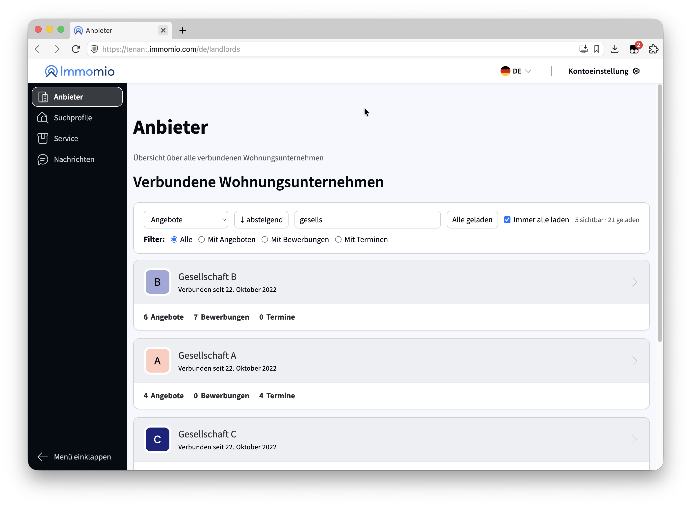

# Immomio – Anbieter sortieren & filtern

[](LICENSE)
[](CHANGELOG.md)
[](https://raw.githubusercontent.com/tekes/immomio-landlord-sort/main/immomio-landlord-sort.user.js)

Aktuell nutze ich Immomio als zusätzlichen Kanal für die Wohnungssuche und das Portal funktioniert grundsätzlich gut, auch wenn es hier und da Schwächen beim Speichern und Abrufen der Daten gibt. Allerdings nervt es mich sehr, dass die Seite keine Such- und Filteroptionen anbietet. Immer wenn ich die Seite besuche, muss ich lange scrollen und am Ende die Browser-Suchfunktion nutzen, um den gesuchten Anbieter zu finden.

Deshalb habe ich dieses Script geschrieben. Es ergänzt die Anbieter-Übersicht im [Immomio-Mieterportal](https://tenant.immomio.com) um eine Toolbar mit Sortierung, Filtern und einem Button zum Laden aller Anbieter. Das Script läuft als Userscript in Tampermonkey oder Violentmonkey oder als entpackte Chrome-Extension.

> **Hinweis:** Das ist ein privates Projekt und hat nichts mit der Immomio GmbH zu tun.



## Inhalt

- [Features](#features)
- [Installation](#installation)
- [Benutzung](#benutzung)
- [Datenschutz](#datenschutz)
- [Funktionsweise](#funktionsweise)
- [Bekannte Einschränkungen](#bekannte-einschränkungen)
- [Mitwirken](#mitwirken)
- [Lizenz](#lizenz)

## Features

- **Sortierung** nach Angeboten, Bewerbungen, Terminen, Aktivität (Summe), Name, „Verbunden seit“ und Suchprofil-Status. Die Richtung lässt sich umkehren.
- **Filter** für alle Anbieter oder nur die mit Angeboten, Bewerbungen oder Terminen
- **Namenssuche** über alle geladenen Anbieter
- **„Alle anzeigen“** lädt alle Seiten auf einmal statt immer nur zehn. Auf Wunsch passiert das automatisch beim Öffnen der Seite.
- **Einstellungen bleiben erhalten.** Sortierung, Filter und Auto-Laden speichert das Script lokal im Browser.
- Funktioniert mit der **deutschen und englischen** Oberfläche

## Installation

### Variante A: Userscript-Manager

1. [Tampermonkey](https://www.tampermonkey.net/) oder [Violentmonkey](https://violentmonkey.github.io/) installieren
2. **Nur für Chrome ab Version 138:** Unter `chrome://extensions` beim Userscript-Manager auf „Details“ klicken und „Nutzerscripts zulassen“ aktivieren. Danach Chrome einmal komplett neu starten.
3. **[Script installieren](https://raw.githubusercontent.com/tekes/immomio-landlord-sort/main/immomio-landlord-sort.user.js)** und im Dialog bestätigen

Updates kommen danach automatisch über den Userscript-Manager.

### Variante B: Entpackte Chrome-Extension

Wer keinen Userscript-Manager nutzen möchte, kann das Repository auch direkt als Extension laden.

1. Repository klonen oder über „Code → Download ZIP“ herunterladen und entpacken
   ```bash
   git clone https://github.com/tekes/immomio-landlord-sort.git
   ```
2. `chrome://extensions` öffnen und oben rechts den **Entwicklermodus** aktivieren
3. Auf **„Entpackte Erweiterung laden“** klicken und den Repository-Ordner auswählen

Für Updates `git pull` ausführen und die Erweiterung in `chrome://extensions` über das Reload-Symbol neu laden.

> Bitte nur eine der beiden Varianten aktivieren. Sonst erscheint die Toolbar doppelt.

## Benutzung

1. Im Mieterportal auf **Anbieter** gehen
2. Die Toolbar erscheint unter „Verbundene Wohnungsunternehmen“
3. Sortierung wählen und bei Bedarf die Richtung umkehren oder einen Filter setzen
4. Auf **„Alle anzeigen“** klicken, damit auch die Anbieter nach den ersten zehn berücksichtigt werden. Alternativ **„Immer alle laden“** aktivieren.

Rechts oben in der Toolbar steht, wie viele Anbieter gerade sichtbar, geladen und insgesamt vorhanden sind.

## Datenschutz

- Das Script schickt keine Anfragen ins Netz und sammelt keine Daten.
- Es liest nur die ohnehin angezeigte Seite und ändert ausschließlich die Darstellung.
- Gespeichert werden nur die Toolbar-Einstellungen im `localStorage` deines Browsers unter dem Key `tm-immomio-landlord-sort`. Der Suchtext wird nicht gespeichert.

Die Einstellungen lassen sich über die Browser-Konsole zurücksetzen:

```js
localStorage.removeItem("tm-immomio-landlord-sort");
```

## Funktionsweise

- Die Anbieter-Liste von Immomio ist ein Flex-Container. Das Script sortiert deshalb über die CSS-Eigenschaft `order` und blendet gefilterte Karten mit `display: none` aus. Die DOM-Knoten bleiben an ihrem Platz und das Angular-Rendering der Seite kommt nicht durcheinander.
- Ein `MutationObserver` bemerkt nachgeladene Karten und Seitenwechsel und wendet Sortierung und Filter dann erneut an.
- „Alle anzeigen“ klickt so lange auf den „Mehr anzeigen“-Button der Seite, bis alle Einträge geladen sind. Nach 60 Sekunden bricht das Script ab.
- Alle CSS-Selektoren stehen gesammelt im Objekt `SELECTORS` am Anfang des Scripts.
- Aufbau: `Settings` für die gespeicherten Einstellungen, `LandlordCard` für eine Anbieter-Karte, `Pagination` und `LandlordLoader` für das Nachladen, `Toolbar` für die Oberfläche und `LandlordOverview` als Steuerung für alles.

## Bekannte Einschränkungen

- Das Script hängt an der HTML-Struktur der Immomio-Seite. Wenn Immomio das Markup ändert, kann die Toolbar verschwinden. In dem Fall freue ich mich über ein [Issue](https://github.com/tekes/immomio-landlord-sort/issues).
- Die Sortierung ist rein visuell. Mit der Tab-Taste springt man weiterhin in der ursprünglichen Reihenfolge durch die Karten.
- Die Toolbar gibt es aktuell nur auf Deutsch.

## Mitwirken

Issues und Pull Requests sind willkommen.

## Lizenz

[MIT](LICENSE) © 2026 Sahin Tekes